# Dot-Files

<p align="center">
  
</p>

This contains all of my dot files and step-by-step instructions on how to build an Arch distribution similar to mine: Hyprland, waybar, NeoVim and zsh. Most configurations are detailed with comments. All dot files are purposefully compact with little ricing; the bar is where the effort went.

## The bar

Every widget in [`packages/waybar`](packages/waybar/.config/waybar), as it looks in the bar. Each one is a small script or a sibling program; the name links to it.

<!-- bar-widgets:start -->
| | Widget | What it does |
|---|---|---|
|  | [Now playing](packages/waybar/.config/waybar/scripts/currently-playing.sh) | The current track from playerctl. Click for the previous track, right-click for the next, middle-click to pause. Hidden while do not disturb is on, so song titles stay off screen shares. |
|  | [Roundhouse](packages/roundhouse/.config/roundhouse/config.toml) | One lamp for the whole machine: green, amber, red. Click it for the [Roundhouse](https://github.com/NathanielInman/roundhouse) drawer: CPU, GPU, memory, disks and why the lamp is lit. |
|  | [Volume](packages/waybar/.config/waybar/scripts/audio-switch.sh) | Volume and output. Click to switch the output, right-click to switch the input, middle-click for the mixer. |
|  | [Mouse battery](packages/waybar/.config/waybar/scripts/mouse-battery.sh) | The Logitech mouse's charge, amber when low, red when nearly empty. |
|  | [Dictation](packages/waybar/.config/waybar/scripts/voxtype-status.sh) | [voxtype](https://voxtype.io) speech to text: hold a key, talk, and it types where the cursor is. Red while listening, amber while transcribing. |
|  | [Meeting recorder](packages/waybar/.config/waybar/scripts/meeting-record.sh) | Records a meeting in 15 minute chunks and transcribes them with voxtype afterwards. Shows only while recording. |
|  | [Screen recorder](packages/waybar/.config/waybar/scripts/screen-record.sh) | Records the screen with wf-recorder. Shows only while recording. |
|  | [Pomodoro](packages/waybar/.config/waybar/scripts/pomodoro.sh) | 25 minutes of focus, then a 5 minute break. Click to start or pause, right-click to reset. |
|  | [Key lights](packages/waybar/.config/waybar/scripts/keylights.sh) | Both Elgato Key Lights on or off in one click, over the IoT network. |
|  | [VPN](packages/waybar/.config/waybar/scripts/vpn.sh) | Connects or drops the work VPN (openvpn3). Right-click lists the sessions. |
|  | [Do not disturb](packages/waybar/.config/waybar/config.jsonc) | Silences notifications (swaync). Also hides the song title while it is on. |
|  | [Switchyard](packages/switchyard/.config/switchyard/config.toml) | The signal for [Switchyard](https://github.com/NathanielInman/switchyard), the board that builds, launches and deploys everything, one heavy build at a time: blue at rest, amber while building, green when it worked, red when it broke. |
|  | [Power](packages/waybar/.config/waybar/scripts/power-menu.sh) | Idle, lock, log out, suspend, reboot or shut down, through walker. |
|  | [Clock](packages/waybar/.config/waybar/scripts/timezone.sh) | The date and time. Click to cycle through Chicago, Eastern Europe and GMT; right-click for the calendar. |
<!-- bar-widgets:end -->

The animation above and these strips are drawn from the real config and stylesheet by [`docs/bar/build.py`](docs/bar/README.md), so they keep up when the bar changes.

## Installation

Aside from referencing the configuration files directly, you can use stow to automatically install any one or multiple of the configurations in this repository. This repository uses [GNU Stow](https://www.gnu.org/software/stow/) for managing symlinks.

```bash
# Packages are 'installed' by merely symlinking the files to their destinations
sudo pacman -S stow

# Clone the repository
git clone https://github.com/NathanielInman/dotfiles.git ~/Sites/dot-files
cd ~/Sites/dot-files

# List available packages
./install.sh -l

# Install all packages
./install.sh -a

# Install specific packages
./install.sh nvim zsh starship

# Uninstall a package
./install.sh -u nvim

# Restow after pulling updates
./install.sh -r nvim
```

### Available Packages

| Package    | Description                                   |
| ---------- | --------------------------------------------- |
| `biome`    | Global Biome formatter/linter config          |
| `cargo`    | Cargo dev profile (small `target/` dirs)      |
| `chrome`   | Chrome Wayland flags (`chrome-flags.conf`)    |
| `git`      | Git configuration (delta pager)               |
| `hyprland` | Wayland compositor (Lua config), lock, idle   |
| `kitty`    | Terminal emulator                             |
| `nushell`  | Modern shell                                  |
| `nvim`     | Standalone lazy.nvim NeoVim config            |
| `pipewire` | rtkit wait + WirePlumber no-suspend drop-ins  |
| `roundhouse` | System drawer config: bar pin, public IP, hidden mounts |
| `starship` | Shell prompt                                  |
| `swaync`   | Notification center                           |
| `switchyard` | Task board config: games, deploys, desk tasks |
| `t3code`   | T3 Code color theme                           |
| `task`     | Taskwarrior + vit config                      |
| `topgrade` | Upgrade-everything config                     |
| `vim`      | Vim configuration                             |
| `walker`   | Application launcher                          |
| `waybar`   | Status bar                                    |
| `zsh`      | Zsh + Oh-My-Zsh config                        |

The `switchyard` package configures [Switchyard](https://github.com/NathanielInman/switchyard), the board behind the signal icon in waybar: it builds and launches the games, runs deploys and holds the small desk scripts, one heavy build at a time. Install the program itself before stowing the package:

```bash
git clone https://github.com/NathanielInman/switchyard.git ~/Sites/switchyard
~/Sites/switchyard/install.sh       # builds, installs yard + yard-board to ~/.local/bin, enables the user units
./install.sh switchyard             # then the config and tasks (packages/switchyard)
```

The `roundhouse` package configures [Roundhouse](https://github.com/NathanielInman/roundhouse), the system drawer behind the lamp in waybar: CPU, GPU, memory pressure, network, every disk and share, memory by app, and a link to the Switchyard board when it runs. It replaced the old `group/details` drawer and its scripts. Install the program first:

```bash
git clone https://github.com/NathanielInman/roundhouse.git ~/Sites/roundhouse
cd ~/Sites/roundhouse && cargo build --release
install -Dm755 target/release/rh target/release/rh-board -t ~/.local/bin/
./install.sh roundhouse             # then the config (packages/roundhouse)
```

System-level files that can't be stowed (because they live outside `$HOME`) are tracked under `etc/`, `usr/` and `scripts/` as copies. Install them via `./install.sh -s`, which prompts for each one (`./install.sh -y -s` answers yes to all; it is safe to run in a chroot, where anything that needs udev or D-Bus waits for first boot). Currently covers:

- `etc/pacman.d/hooks/hyprpm.hook`: rebuilds hyprpm plugins automatically after Hyprland upgrades so boot doesn't complain about outdated plugin headers. Only offered when `hyprpm` (a separate package since Hyprland 0.57) is installed; no plugins are in use today.
- `scripts/hypr-launch` -> `/usr/local/bin/hypr-launch`: sets the NVIDIA/Wayland env and execs Hyprland's own `start-hyprland` watchdog on tty1 login.
- `etc/nvidia/nvidia-application-profiles-rc.d/50-limit-free-buffer-pool-in-wayland-compositors.json`: stops the NVIDIA driver hoarding VRAM freed by Hyprland.
- `etc/udev/rules.d/50-bt-adapter-no-autosuspend.rules`: keeps the UB500 Bluetooth dongle from autosuspending.
- `etc/udev/rules.d/52-disable-onboard-bt.rules`: turns off the onboard MediaTek Bluetooth so only the UB500 is used.
- `usr/local/bin/bt-force-central` + `etc/systemd/system/bt-force-central.service` + `etc/udev/rules.d/51-bt-force-central.rules`: forces the PC to the central role on new Bluetooth links (fixes headset audio stutter).
- `etc/systemd/system/rime-umount.service`: unmounts the Rime CIFS share early on shutdown so it doesn't hang.
- `scripts/openvpn3-tun-dns` + `etc/systemd/system/openvpn3-tun-dns@.service`: VPN DNS hook (see below).

`usr/share/applications/` holds `.desktop` overrides (mostly `NoDisplay=true` to hide unwanted apps from walker); copy them to `/usr/share/applications/` by hand.

### Package manifest

`pkglist/repo.txt` (official repos, multilib included) and `pkglist/aur.txt` list every explicitly installed package on the desktop, so a rebuild installs everything in one pass instead of section by section:

```bash
grep -v '^#' pkglist/repo.txt | sudo pacman -S --needed -   # or: pacstrap -K -P /mnt $(grep -v '^#' pkglist/repo.txt)
grep -v '^#' pkglist/aur.txt  | paru -S --needed -
```

`scripts/pkglist-refresh.sh` regenerates both from `pacman -Qqe` at 2:55am, just before the nightly backup commits and pushes them. The setup guide still explains why each package is there.

### Rebuilding the desktop

`rebuild/` turns the guide's one-reboot order into scripts: `bootstrap.sh` on the live ISO, `10-live.sh` for everything up to the reboot, `40-first-boot.sh` for the restore afterwards. Each step is critical (stop and hand it to a person) or minor (record it in `/var/log/rebuild/followups.md` for Claude to fix after first boot). See [rebuild/README.md](rebuild/README.md). `etc/udev/rules.d/50-zsa.rules` and `70-titan-key.rules` are installed by the rebuild.

## Automation

`scripts/` holds the cron helpers (set up via `crontab -e`, see [docs/setting-up-archlinux.md](docs/setting-up-archlinux.md)) and a few other tools:

- `cron-git-notes-auto-update.sh` / `cron-git-tasks-auto-update.sh`: keep the `notes` and `tasks` repos synced hourly.
- `cron-sites-nightly-backup.sh`: a 3am safety net so no uncommitted work in `~/Sites` is ever lost to a dead disk. Owned repos get an atomic commit + push on the current branch; every other dirty repo is snapshotted non-destructively to a `backup/auto/<host>/<branch>` ref on its remote. Full write-up: [docs/sites-nightly-backup.md](docs/sites-nightly-backup.md).
- `openvpn3-tun-dns`: attaches the DigitalTurbine CloudConnexa DNS resolver to the `tun0` link on every VPN connect (via `openvpn3-tun-dns@tun0.service`), because `openvpn3` doesn't apply the pushed DNS itself and internal hosts won't otherwise resolve. Full write-up: [docs/openvpn3-vpn-dns.md](docs/openvpn3-vpn-dns.md).
- `pkglist-refresh.sh`: rewrites `pkglist/` from what is installed (cron, 2:55am).
- `statusline-command.sh`: custom Claude Code statusline (see [docs/setting-up-archlinux.md](docs/setting-up-archlinux.md#claude-code-statusline)).

> [!TIP]
> Clicking on the Arch, NeoVim, Zsh and PragmataPro icons below leads to this repository's setup docs or config for that tool.

## My Everyday Stack

[](docs/setting-up-archlinux.md#setting-up-archlinux) [](packages/nvim/.config/nvim/README.md) [](packages/zsh/.zshrc) [](docs/fonts.md)

## My Common Stacks

[](https://www.cloudflare.com/) [](https://claude.ai/) [](https://gemini.google.com/) [](https://proton.me/) [](https://www.adobe.com/products/illustrator.html) [](https://www.adobe.com/products/photoshop.html) [](https://www.blender.org/) [](https://bevyengine.org/) [](https://godotengine.org/) [](https://store.steampowered.com/) [](https://www.google.com/chrome/)

## Who Am I

I'm a software engineer who makes Roguelikes for fun, enjoys WebGL, javascript, golang & rust.
| |
| :-: |
| [](https://github.com/nathanielinman) |
| [](https://go.dev/) [](https://tc39.es/) [](https://nodejs.org/en/) [](https://www.typescriptlang.org/) [](https://www.python.org/) [](https://www.rust-lang.org/) [](https://www.lua.org/) [](https://www.r-project.org/) |
| [](https://www.linkedin.com/in/nathanielinman) [](https://www.goodreads.com/user/show/95582054-nathaniel-inman) [](https://github.com/nathanielinman) [](https://gitlab.com/nathaniel.inman) [](https://codepen.io/NathanielInman) |
|  |
| [](http://keyhero.com/profile/nathanielinman/?ba) |
