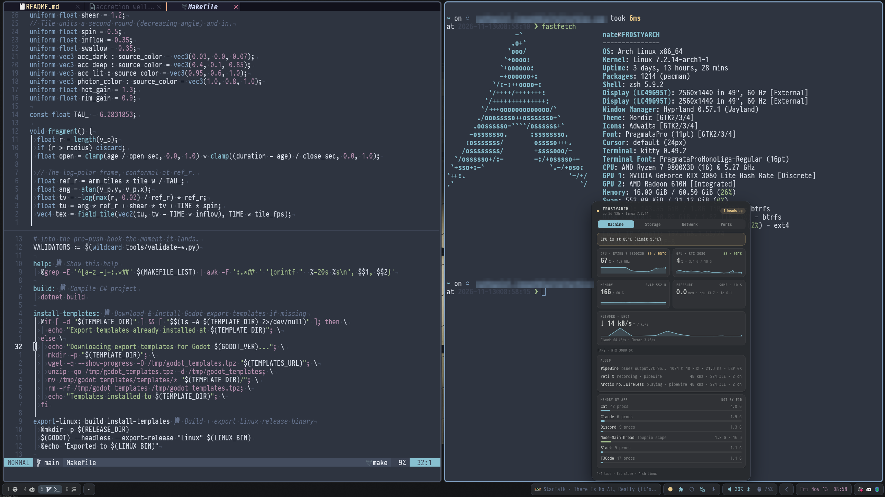

# Arch + Hyprland dotfiles

<p align="center">
  
</p>

<p align="center">
  <a href="docs/setting-up-archlinux.md"></a>
  <a href="packages/hyprland/.config/hypr"></a>
  <a href="packages/nvim/.config/nvim/README.md"></a>
  <a href="packages/zsh/.zshrc"></a>
  <a href="docs/fonts.md"></a>
</p>

<p align="center">
  <a href="#quick-start">Quick start</a> ·
  <a href="#the-bar">The bar</a> ·
  <a href="#packages">Packages</a> ·
  <a href="#field-notes">Field notes</a> ·
  <a href="#rebuilding-a-machine">Rebuilding a machine</a>
</p>

My Arch Linux desktop: Hyprland, waybar, kitty, zsh and Neovim. Each tool is its own [GNU Stow](https://www.gnu.org/software/stow/) package, so you can take the bar or the editor and leave the rest. The configs stay compact and commented; the bar is where the effort went.

- **Hyprland in Lua.** There is no `hyprland.conf`. Binds, rules, monitors and idle are all [Lua files](packages/hyprland/.config/hypr).
- **A bar made of small scripts.** Each widget below is one script you can drop into your own waybar, and the table says what it needs.
- **A suite behind the bar.** Seven lamps open programs of their own: [Roundhouse](https://github.com/NathanielInman/roundhouse) for the machine's health, [Switchyard](https://github.com/NathanielInman/switchyard) for builds and deploys, [Signal Box](https://github.com/NathanielInman/credential-broker#signal-box) for the secrets agents hold, [Tannoy](https://github.com/NathanielInman/tannoy) for what's playing, [Logbook](https://github.com/NathanielInman/logbook) for the mic, [Timetable](https://github.com/NathanielInman/timetable) for the day and [Tablet](https://github.com/NathanielInman/tablet) for the work VPN. The tour above opens each one.
- **Pictures that can't go stale.** The animation above and the widget strips are drawn from the real config and stylesheet by [`docs/bar/build.py`](docs/bar/README.md), not screenshotted, so they change when the bar does. Each app's panel comes from that app's own README animation, so it changes when the app does.
- **A one-reboot rebuild.** [`rebuild/`](rebuild/README.md) takes a blank machine from the Arch ISO to a working Hyprland session with every package installed.
- **[Field notes](#field-notes)** for the problems real hardware threw at it, so you don't lose the evening I did.

<p align="center">
  
  <br><sub>The real thing: Neovide on the waybar stylesheet and the Lua window rules, kitty, and the Roundhouse drawer open over the bar.</sub>
</p>

## Quick start

```bash
sudo pacman -S stow
git clone https://github.com/NathanielInman/dotfiles.git ~/Sites/dot-files
cd ~/Sites/dot-files

./install.sh -l              # list the packages
./install.sh waybar nvim     # link just those into ~
./install.sh -a              # or everything
```

`./install.sh -u nvim` removes a package and `./install.sh -r nvim` restows it after a pull. Stow refuses to overwrite a real file, so move an existing config aside before installing over it.

## The bar

Every widget in [`packages/waybar`](packages/waybar/.config/waybar), as it looks in the bar. The name links to the script or program behind it.

<!-- bar-widgets:start -->
| | Widget | What it does | Needs |
|---|---|---|---|
|  | [Tannoy](packages/waybar/.config/waybar/config.jsonc) | Now playing from any MPRIS player, the cover beside it and the text cut at a word. Click for the [Tannoy](https://github.com/NathanielInman/tannoy) drawer: scrub, podcast skips, which player the media keys follow, the output device. Right-click skips, middle-click pauses, scroll seeks. While do not disturb is on only a dim note shows, so titles stay off screen shares. | [Tannoy](https://github.com/NathanielInman/tannoy), `swaync` |
|  | [Roundhouse](packages/roundhouse/.config/roundhouse/config.toml) | One lamp for the whole machine: green, amber, red. Click it for the [Roundhouse](https://github.com/NathanielInman/roundhouse) drawer: CPU, GPU, memory, disks and why the lamp is lit. | [Roundhouse](https://github.com/NathanielInman/roundhouse) |
|  | [Switchyard](packages/switchyard/.config/switchyard/config.toml) | The signal for [Switchyard](https://github.com/NathanielInman/switchyard), the board that builds, launches and deploys everything, one heavy build at a time: blue at rest, amber while building, green when it worked, red when it broke. | [Switchyard](https://github.com/NathanielInman/switchyard) |
|  | [Signal Box](packages/waybar/.config/waybar/config.jsonc) | The lamp for [Signal Box](https://github.com/NathanielInman/credential-broker#signal-box): the secrets agents can use right now through broker. The pie drains with the soonest grant and turns to a key while an agent is asking. Click for the panel, middle-click revokes everything. | [credential-broker](https://github.com/NathanielInman/credential-broker) |
|  | [Tablet](packages/tablet/.config/tablet/config.toml) | The lamp for [Tablet](https://github.com/NathanielInman/tablet), the work VPN through openvpn3: frost only while the tunnel is up and its probes answer, amber while it connects or waits on the web sign-in or an agent's request, orange when openvpn3 says connected but nothing gets through, red when it failed or dropped. Click connects, right-click opens the drawer, middle-click checks now. | [Tablet](https://github.com/NathanielInman/tablet), `openvpn3` |
|  | [Do not disturb](packages/waybar/.config/waybar/config.jsonc) | Silences notifications (swaync). Also hides the song title while it is on. | `swaync` |
|  | [Volume](packages/waybar/.config/waybar/scripts/audio-switch.sh) | Volume and output. Click to switch the output, right-click to switch the input, middle-click for the mixer. | PipeWire (`wpctl`), `walker`, `pavucontrol` |
|  | [Mouse battery](packages/waybar/.config/waybar/scripts/mouse-battery.sh) | The Logitech mouse's charge, amber when low, red when nearly empty. | A Logitech mouse (kernel `hidpp` driver) |
|  | [Logbook](packages/waybar/.config/waybar/config.jsonc) | One On Air lamp for the mic: dim while nothing listens, frost while another app has the mic, red with a running clock while a meeting or the screen records, red while dictating, amber while a transcript is made. Click for the [Logbook](https://github.com/NathanielInman/logbook) drawer: the live recording with Stop and Mark, who else has the mic, every recording and its transcript with Copy. Right-click stops, middle-click dictates. | [Logbook](https://github.com/NathanielInman/logbook), [voxtype](https://voxtype.io), `wf-recorder`, `slurp`, `ffmpeg` |
|  | [Key lights](packages/waybar/.config/waybar/scripts/keylights.sh) | Both Elgato Key Lights on or off in one click, over the IoT network. | Elgato Key Lights, `curl` (set the light's IP in the script) |
|  | [Power](packages/waybar/.config/waybar/scripts/power-menu.sh) | Idle, lock, log out, suspend, reboot or shut down, through walker. | `walker`, `hyprlock`, `hypridle` |
|  | [Timetable](packages/timetable/.config/timetable/config.toml) | The clock with your next meeting beside it: amber 10 minutes out, red with Join at start time, a countdown during a focus block. Click for the [Timetable](https://github.com/NathanielInman/timetable) drawer: Chicago, EET and GMT side by side, Join on workspace 2, the day with its free gaps, and focus blocks that end before the next meeting. Middle-click joins, right-click opens the calendar. | [Timetable](https://github.com/NathanielInman/timetable), a Google Calendar secret iCal address in broker |
<!-- bar-widgets:end -->

To use one widget without the rest, copy its script into `~/.config/waybar/scripts/`, its block from [`config.jsonc`](packages/waybar/.config/waybar/config.jsonc) and its `#custom-<name>` rules from [`style.css`](packages/waybar/.config/waybar/style.css). The key lights, for example:

```jsonc
"custom/keylights": {
  "exec": "~/.config/waybar/scripts/keylights.sh",
  "return-type": "json",
  "interval": 60,
  "signal": 10,
  "on-click": "~/.config/waybar/scripts/keylights-toggle.sh"
}
```

## Packages

| | Package | What it holds |
| --- | --- | --- |
| Desktop | `hyprland` | Wayland compositor (Lua config), lock and idle |
| | `waybar` | The bar above |
| | `walker` | Application launcher, also used for menus |
| | `swaync` | Notification center |
| | `kitty` | Terminal |
| | `pipewire` | rtkit wait and WirePlumber no-suspend drop-ins |
| | `chrome` | Chrome Wayland flags |
| Shell | `zsh` | Zsh and Oh My Zsh |
| | `starship` | Prompt |
| | `nushell` | Second shell |
| Editors | `nvim` | Standalone lazy.nvim config ([README](packages/nvim/.config/nvim/README.md)) |
| | `vim` | Vim config |
| Dev tools | `git` | Git config with the delta pager |
| | `biome` | Global Biome formatter and linter config |
| | `cargo` | Cargo dev profile that keeps `target/` small |
| | `task` | Taskwarrior and vit |
| | `topgrade` | Upgrade everything in one command |
| | `paru` | AUR helper config: removes build-only dependencies after each install |
| | `t3code` | T3 Code color theme |
| Companions | `roundhouse` | Config for the Roundhouse drawer (see below) |
| | `switchyard` | Tasks for the Switchyard board (see below) |
| | `timetable` | Where Timetable reads the calendar, and the purple clock (see below) |

### Companion programs

Seven widgets are front ends for programs that live in their own repos. Install the program, then stow its package here (Signal Box, Tannoy and Logbook need nothing stowed: their modules are already in the waybar config).

[**Roundhouse**](https://github.com/NathanielInman/roundhouse) is the lamp: one color for the health of the whole machine, and a drawer with CPU, GPU, memory pressure, network, every disk and share, and memory by app.

```bash
git clone https://github.com/NathanielInman/roundhouse.git ~/Sites/roundhouse
cd ~/Sites/roundhouse && cargo build --release
install -Dm755 target/release/rh target/release/rh-board -t ~/.local/bin/
cd ~/Sites/dot-files && ./install.sh roundhouse
```

[**Switchyard**](https://github.com/NathanielInman/switchyard) is the signal: a board that builds and launches the games, runs deploys and holds small desk scripts, one heavy build at a time.

```bash
git clone https://github.com/NathanielInman/switchyard.git ~/Sites/switchyard
~/Sites/switchyard/install.sh       # installs yard and yard-board, enables the user units
cd ~/Sites/dot-files && ./install.sh switchyard
```

[**Signal Box**](https://github.com/NathanielInman/credential-broker#signal-box) is the key: the secrets agents can use right now through broker, how long each has left, the requests nobody answered, and a revoke for all of it. It comes with credential-broker; the panel needs `gtk-layer-shell`.

```bash
sudo pacman -S --needed gtk-layer-shell
cd ~/Sites/credential-broker/packaging/aur/credential-broker-bin && makepkg -si
```

[**Tannoy**](https://github.com/NathanielInman/tannoy) is now playing: the cover and the track from any MPRIS player, cut at a word, and a drawer with a scrub bar, podcast skips, the player the media keys follow and the output device. While do not disturb is on, only a dim note shows. The media keys in `binds.lua` go through it too.

```bash
sudo pacman -S --needed gtk4 gtk4-layer-shell
git clone https://github.com/NathanielInman/tannoy.git ~/Sites/tannoy
cd ~/Sites/tannoy && cargo build --release
install -Dm755 target/release/tannoy target/release/tannoy-board -t ~/.local/bin/
tannoy doctor
```

[**Logbook**](https://github.com/NathanielInman/logbook) is the mic lamp: one icon for meetings, screen captures, dictation and any other app with the mic open, and a drawer with the live recording (Stop, Mark), the recordings on disk and their transcripts. It replaced `meeting-record.sh`, `screen-record.sh` and `voxtype-status.sh`. A stopped meeting queues its transcript in Switchyard as a heavy task (`tasks.d/logbook.toml` in the `switchyard` package), so it waits behind builds. F14 (`code:192`) records a meeting, Shift+F14 drops a mark that becomes a heading in the transcript, and Super+R records a region of the screen.

```bash
sudo pacman -S --needed gtk4 gtk4-layer-shell clang wf-recorder slurp ffmpeg
git clone https://github.com/NathanielInman/logbook.git ~/Sites/logbook
cd ~/Sites/logbook && cargo build --release
install -Dm755 target/release/logbook target/release/logbook-board -t ~/.local/bin/
logbook setup --systemd     # the Switchyard task and the user service
logbook doctor
```

[**Timetable**](https://github.com/NathanielInman/timetable) is the clock: the next meeting beside the time, amber 10 minutes out and red with Join at start time, and a drawer with Chicago, EET and GMT, the day with its free gaps, and focus blocks that end two minutes before the next meeting (it replaced the pomodoro and `timezone.sh`). It reads Google Calendar's secret iCal address, which lives in broker as `TIMETABLE_ICAL_URL` (public tier, so no touch), never in a file here. Join switches to workspace 2 and opens the Zoom or Meet link; reminders at 5 and 1 minutes go through swaync.

```bash
sudo pacman -S --needed gtk4 gtk4-layer-shell
git clone https://github.com/NathanielInman/timetable.git ~/Sites/timetable
cd ~/Sites/timetable && cargo build --release
install -Dm755 target/release/timetable target/release/timetable-board -t ~/.local/bin/
broker set TIMETABLE_ICAL_URL --public --desc "Google Calendar secret iCal address for Timetable"
cd ~/Sites/dot-files && ./install.sh timetable
timetable doctor
```

[**Tablet**](https://github.com/NathanielInman/tablet) is the VPN lamp: frost only while the openvpn3 tunnel is up and its probes (Grafana and Nexus) answer through it, orange when openvpn3 says connected but nothing gets through, red when it failed or dropped, and `rebuild` when a library update broke the AUR build of openvpn3. It replaced `vpn.sh`, which counted any session object as connected. The drawer has the probes, the tunnel's DNS (still applied by the `openvpn3-tun-dns` hook; Tablet checks it), openvpn3's health with a Repair button that rebuilds it in a terminal, and the history. Agents use `tablet why <host>` before blaming a service and `tablet need dt -- <command>` to ask for the VPN.

```bash
sudo pacman -S --needed gtk4 gtk4-layer-shell
git clone https://github.com/NathanielInman/tablet.git ~/Sites/tablet
cd ~/Sites/tablet && cargo build --release
install -Dm755 target/release/tablet target/release/tablet-board -t ~/.local/bin/
cd ~/Sites/dot-files && ./install.sh tablet
tablet doctor
```

## Field notes

Fixes for things that broke on this machine, each written up where it lives:

- [NVIDIA hoards VRAM under Hyprland](docs/system-files.md#nvidia-hoards-vram-under-hyprland): one driver profile setting stops the leak. Downgrading doesn't.
- [Bluetooth headset stutters at full signal](docs/system-files.md#bluetooth-headset-stutters-at-full-signal): the PC had ended up as the peripheral. A udev rule switches it back on every link.
- [openvpn3 ignores the DNS the server pushes](docs/openvpn3-vpn-dns.md), so internal hosts don't resolve.
- [Don't name your launcher `start-hyprland`](docs/system-files.md#starting-hyprland-on-tty1): it shadows Hyprland's own crash watchdog.
- [Never losing uncommitted work](docs/sites-nightly-backup.md): a 3am job commits or snapshots every dirty repo in `~/Sites`.
- [A Claude Code statusline](docs/setting-up-archlinux.md#claude-code-statusline) with context, usage window and cost.
- [Drawing the README's bar from the real config](docs/bar/README.md), and adding a widget to it.

## Rebuilding a machine

[`docs/setting-up-archlinux.md`](docs/setting-up-archlinux.md) is the full guide for my desktop (Ryzen 9800X3D, RTX 3080, three NVMe drives) and explains why each package is there. [`rebuild/`](rebuild/README.md) scripts it with one reboot: `bootstrap.sh` and `10-live.sh` on the live ISO, `40-first-boot.sh` afterwards. A step that fails either stops and hands over to a person or, if it's minor, goes in `/var/log/rebuild/followups.md` for later.

[`pkglist/`](pkglist) lists every explicitly installed package, refreshed nightly, so a rebuild installs everything in one pass:

```bash
grep -v '^#' pkglist/repo.txt | sudo pacman -S --needed -
grep -v '^#' pkglist/aur.txt  | paru -S --needed -
```

Files outside `$HOME` (udev rules, systemd units, the NVIDIA profile, the Hyprland launcher) install with `./install.sh -s`. [`docs/system-files.md`](docs/system-files.md) says what each one does.

---

<p align="center">
  I'm Nathaniel Inman, a software engineer who makes roguelikes for fun.<br>
  <a href="https://nathanielinman.com">nathanielinman.com</a> ·
  <a href="https://github.com/NathanielInman">GitHub</a> ·
  <a href="https://www.linkedin.com/in/nathanielinman">LinkedIn</a> ·
  <a href="https://codepen.io/NathanielInman">CodePen</a>
</p>
