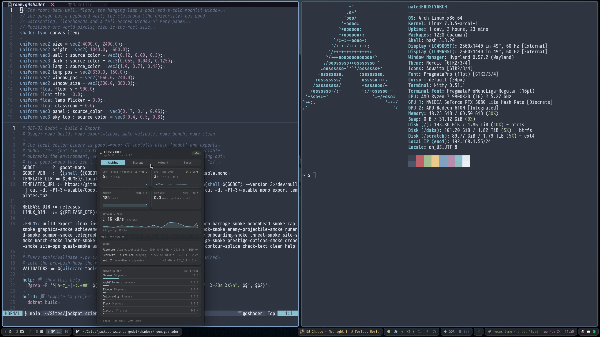

# Arch + Hyprland dotfiles

<p align="center">
  
</p>

<p align="center">
  <a href="docs/setting-up-archlinux.md"></a>
  <a href="packages/hyprland/.config/hypr"></a>
  <a href="packages/nvim/.config/nvim/README.md"></a>
  <a href="packages/zsh/.zshrc"></a>
  <a href="docs/fonts.md"></a>
</p>

<p align="center">
  <a href="#quick-start">Quick start</a> ·
  <a href="#the-bar">The bar</a> ·
  <a href="#the-suite">The suite</a> ·
  <a href="#packages">Packages</a> ·
  <a href="#field-notes">Field notes</a> ·
  <a href="#rebuilding-a-machine">Rebuilding a machine</a>
</p>

My Arch Linux desktop: Hyprland, waybar, kitty, zsh and Neovim, and the programs I wrote to run the bar. Each tool is its own [GNU Stow](https://www.gnu.org/software/stow/) package, so you can take the bar or the editor and leave the rest. The configs stay compact and commented; the bar is where the effort went.

- **Hyprland in Lua.** There is no `hyprland.conf`. Binds, rules, monitors and autostart are all [Lua files](packages/hyprland/.config/hypr). <!-- suite-summary:start -->
- **A bar of real programs.** Nine of the bar's fifteen widgets are apps with their own repos: a `bar` command that waybar runs, and a drawer or board that opens from the lamp. Eight are Rust and credential-broker (Signal Box) is Go, over 100,000 lines and 750 tests between them. The rest are five shell scripts and do not disturb, small enough to drop into your own waybar, and the table says what each one needs.
- **[A suite behind the bar](#the-suite).** [Tannoy](https://github.com/NathanielInman/tannoy) for what's playing, [Roundhouse](https://github.com/NathanielInman/roundhouse) for the machine's health, [Switchyard](https://github.com/NathanielInman/switchyard) for builds and deploys, [Waybill](https://github.com/NathanielInman/waybill) for the task list my agents work from, [Signal Box](https://github.com/NathanielInman/credential-broker#signal-box) for the secrets agents hold, [Tablet](https://github.com/NathanielInman/tablet) for the work VPN, [Logbook](https://github.com/NathanielInman/logbook) for the mic, [Layover](https://github.com/NathanielInman/layover) for the screensaver and idle and [Timetable](https://github.com/NathanielInman/timetable) for the day. The tour above opens each one. <!-- suite-summary:end -->
- **The apps talk to each other.** A stopped meeting in Logbook queues its transcript in Switchyard, behind any build. Layover won't start the saver while Logbook is on air or a meeting is minutes away, and draws at half rate while Switchyard builds. Timetable reads its calendar address from broker, and agents ask Tablet for the VPN and Waybill for my decisions instead of guessing.
- **Pictures that can't go stale.** The animation above and the widget strips are drawn from the real config and stylesheet by [`docs/bar/build.py`](docs/bar/README.md), not screenshotted, so they change when the bar does. Each app's panel comes from that app's own README animation, so it changes when the app does.
- **A one-reboot rebuild.** [`rebuild/`](rebuild/README.md) takes a blank machine from the Arch ISO to a working Hyprland session with every package installed.
- **[Field notes](#field-notes)** for the problems real hardware threw at it, so you don't lose the evening I did.

<p align="center">
  
  <br><sub>The real thing: Neovide on a Godot shader and a Makefile, kitty, and the Roundhouse drawer open over the bar.</sub>
</p>

## Quick start

```bash
sudo pacman -S stow
git clone https://github.com/NathanielInman/dotfiles.git ~/Sites/dot-files
cd ~/Sites/dot-files

./install.sh -l              # list the packages
./install.sh waybar nvim     # link just those into ~
./install.sh -a              # or everything
```

`./install.sh -u nvim` removes a package and `./install.sh -r nvim` restows it after a pull. Stow refuses to overwrite a real file, so move an existing config aside before installing over it. Stowing `waybar` alone leaves the app lamps blank until the apps are installed; see [The suite](#the-suite).

## The bar

Every widget in [`packages/waybar`](packages/waybar/.config/waybar), as it looks in the bar. The name links to the script or program behind it.

<!-- bar-widgets:start -->
| | Widget | What it does | Needs |
|---|---|---|---|
|  | [Tannoy](https://github.com/NathanielInman/tannoy) | Now playing from any MPRIS player, the cover beside it and the text cut at a word. Click for the [Tannoy](https://github.com/NathanielInman/tannoy) drawer: scrub, podcast skips, which player the media keys follow, the output device. Right-click skips, middle-click pauses, scroll seeks. While do not disturb is on only a dim note shows, so titles stay off screen shares. | [Tannoy](https://github.com/NathanielInman/tannoy), `swaync` |
|  | [Roundhouse](https://github.com/NathanielInman/roundhouse) | One lamp for the whole machine: green, amber, red. Click it for the [Roundhouse](https://github.com/NathanielInman/roundhouse) drawer: CPU, GPU, memory, disks and why the lamp is lit. | [Roundhouse](https://github.com/NathanielInman/roundhouse) |
|  | [Switchyard](https://github.com/NathanielInman/switchyard) | The signal for [Switchyard](https://github.com/NathanielInman/switchyard), the board that builds, launches and deploys everything, one heavy build at a time: blue at rest, amber while building, green when it worked, red when it broke. | [Switchyard](https://github.com/NathanielInman/switchyard) |
|  | [Waybill](https://github.com/NathanielInman/waybill) | The lamp for [Waybill](https://github.com/NathanielInman/waybill), the task board my agents work from: dim until a task of mine holds other work up or a decision is waiting on me, then amber with how many. Click opens the drawer, where a decision is settled with one click; right-click brings the board on workspace 6 forward. | [Waybill](https://github.com/NathanielInman/waybill), `task` |
|  | [Signal Box](https://github.com/NathanielInman/credential-broker#signal-box) | The lamp for [Signal Box](https://github.com/NathanielInman/credential-broker#signal-box): the secrets agents can use right now through broker. The pie drains with the soonest grant and turns to a key while an agent is asking. Click for the panel, middle-click revokes everything. | [credential-broker](https://github.com/NathanielInman/credential-broker) |
|  | [Tablet](https://github.com/NathanielInman/tablet) | The lamp for [Tablet](https://github.com/NathanielInman/tablet), the work VPN through openvpn3: frost only while the tunnel is up and its probes answer, amber while it connects or waits on the web sign-in or an agent's request, orange when openvpn3 says connected but nothing gets through, red when it failed or dropped. Click connects, right-click opens the drawer, middle-click checks now. | [Tablet](https://github.com/NathanielInman/tablet), `openvpn3` |
|  | [Logbook](https://github.com/NathanielInman/logbook) | One On Air lamp for the mic: dim while nothing listens, frost while another app has the mic, red with a running clock while a meeting or the screen records, red while dictating, amber while a transcript is made. Click for the [Logbook](https://github.com/NathanielInman/logbook) drawer: the live recording with Stop and Mark, who else has the mic, every recording and its transcript with Copy. Right-click stops, middle-click dictates. | [Logbook](https://github.com/NathanielInman/logbook), [voxtype](https://voxtype.io), `wf-recorder`, `slurp`, `ffmpeg` |
|  | [Layover](https://github.com/NathanielInman/layover) | The moon for [Layover](https://github.com/NathanielInman/layover), the screensaver that replaced hypridle: dim while armed, amber while a video, a call, playing audio (for the dark) or a hold keeps the screen on, and the tooltip says which. After 15 minutes idle a hack runs; after an hour the session locks and the screens turn off. Click for the Layover drawer: the idle line now with Start and Hold, every hack with its wear numbers and a preview, and the history of what the line did and why. Middle-click starts the saver now, right-click holds everything for an hour. | [Layover](https://github.com/NathanielInman/layover), `hyprlock`, `pactl` |
|  | [Volume](packages/waybar/.config/waybar/scripts/audio-switch.sh) | Volume and output. Click to switch the output, right-click to switch the input, middle-click for the mixer. | PipeWire (`wpctl`), `walker`, `pavucontrol` |
|  | [Mouse battery](packages/waybar/.config/waybar/scripts/mouse-battery.sh) | The Logitech mouse's charge, amber when low, red when nearly empty. | A Logitech mouse (kernel `hidpp` driver) |
|  | [Do not disturb](packages/waybar/.config/waybar/config.jsonc) | Silences notifications (swaync). It waits in the desk drawer and steps out of it while it is on, which also hides the song title. | `swaync` |
|  | [Key lights](packages/waybar/.config/waybar/scripts/keylights.sh) | Both Elgato Key Lights on or off in one click, over the IoT network. | Elgato Key Lights, `curl` (set the light's IP in the script) |
|  | [Power](packages/waybar/.config/waybar/scripts/power-menu.sh) | Idle, lock, log out, suspend, reboot or shut down, through walker. | `walker`, `hyprlock` |
|  | [Timetable](https://github.com/NathanielInman/timetable) | The clock with your next meeting beside it: amber 10 minutes out, red with Join at start time, a countdown during a focus block. Click for the [Timetable](https://github.com/NathanielInman/timetable) drawer: Chicago, EET and GMT side by side, Join on workspace 2, the day with its free gaps, and focus blocks that end before the next meeting. Middle-click joins, right-click opens the calendar. | [Timetable](https://github.com/NathanielInman/timetable), a Google Calendar secret iCal address in broker |
|  | [Steam](packages/waybar/.config/waybar/scripts/steam-friends.sh) | Steam's icon, shown while Steam runs, in place of its tray icon (which has no unread dot and ignores a click). Click floats the Friends List or hides it; right-click opens Steam's own menu: Friends, Library, Store and Settings. | `steam` |
<!-- bar-widgets:end -->

To use one widget without the rest, copy its script into `~/.config/waybar/scripts/`, its block from [`config.jsonc`](packages/waybar/.config/waybar/config.jsonc) and its `#custom-<name>` rules from [`style.css`](packages/waybar/.config/waybar/style.css). The key lights, for example:

```jsonc
"custom/keylights": {
  "exec": "~/.config/waybar/scripts/keylights.sh",
  "return-type": "json",
  "interval": 60,
  "signal": 10,
  "on-click": "~/.config/waybar/scripts/keylights-toggle.sh"
}
```

## The suite

<!-- suite:start -->
Nine of the widgets are front ends for apps that live in their own repos. Each app describes itself in a `suite.toml` beside its README hero, and `docs/bar/build.py` writes this section from those files, so it changes when an app does.

| App | In the bar | Replaced | Built in | Stow here |
|---|---|---|---|---|
| [Tannoy](https://github.com/NathanielInman/tannoy) | The cover and song from any MPRIS player | `currently-playing.sh` | Rust |  |
| [Roundhouse](https://github.com/NathanielInman/roundhouse) | Green, amber or red for the whole machine, and a drawer that says why |  | Rust | `roundhouse` |
| [Switchyard](https://github.com/NathanielInman/switchyard) | The build signal: blue at rest, amber building, green or red when it ends |  | Rust | `switchyard` |
| [Waybill](https://github.com/NathanielInman/waybill) | Amber when a decision or a task of yours holds work up | `vit` | Rust | `waybill` |
| [Signal Box](https://github.com/NathanielInman/credential-broker#signal-box) | A pie that drains with the soonest grant, a key while an agent asks |  | Go |  |
| [Tablet](https://github.com/NathanielInman/tablet) | Frost only while the VPN's probes answer through it | `vpn.sh` | Rust | `tablet` |
| [Logbook](https://github.com/NathanielInman/logbook) | On Air for meetings, captures, dictation and any app with the mic | `meeting-record.sh`, `screen-record.sh`, `voxtype-status.sh` | Rust |  |
| [Layover](https://github.com/NathanielInman/layover) | The moon: dim while armed, amber while something holds the screen on | `hypridle` | Rust |  |
| [Timetable](https://github.com/NathanielInman/timetable) | The clock, with the next meeting beside it | `timezone.sh`, `pomodoro.sh` | Rust | `timetable` |

Install an app, then stow its package here if it has one. Each block runs from a clean Arch install:

<details><summary>Tannoy</summary>

```bash
sudo pacman -S --needed gtk4 gtk4-layer-shell
git clone https://github.com/NathanielInman/tannoy.git ~/Sites/tannoy
cd ~/Sites/tannoy && cargo build --release
install -Dm755 target/release/tannoy target/release/tannoy-board -t ~/.local/bin/
tannoy doctor
```

</details>

<details><summary>Roundhouse</summary>

```bash
sudo pacman -S --needed gtk4 gtk4-layer-shell
git clone https://github.com/NathanielInman/roundhouse.git ~/Sites/roundhouse
cd ~/Sites/roundhouse && cargo build --release
install -Dm755 target/release/rh target/release/rh-board -t ~/.local/bin/
cd ~/Sites/dot-files && ./install.sh roundhouse
rh doctor
```

</details>

<details><summary>Switchyard</summary>

```bash
sudo pacman -S --needed gtk4 gtk4-layer-shell libnotify
git clone https://github.com/NathanielInman/switchyard.git ~/Sites/switchyard
~/Sites/switchyard/install.sh   # installs yard and yard-board, runs yard setup
cd ~/Sites/dot-files && ./install.sh switchyard
yard doctor
```

</details>

<details><summary>Waybill</summary>

```bash
sudo pacman -S --needed gtk4 gtk4-layer-shell task
git clone https://github.com/NathanielInman/waybill.git ~/Sites/waybill
cd ~/Sites/waybill && cargo build --release
install -Dm755 target/release/waybill target/release/waybill-board -t ~/.local/bin/
install -Dm644 packaging/io.github.nathanielinman.Waybill.desktop -t ~/.local/share/applications
cd ~/Sites/dot-files && ./install.sh waybill
waybill doctor
```

</details>

<details><summary>Signal Box</summary>

```bash
sudo pacman -S --needed age gtk3 webkit2gtk-4.1 pcsclite ccid age-plugin-yubikey yubikey-manager
sudo pacman -S --needed gtk4-layer-shell webkitgtk-6.0   # for Signal Box
sudo systemctl enable --now pcscd.socket
git clone https://github.com/NathanielInman/credential-broker.git ~/Sites/credential-broker
cd ~/Sites/credential-broker/packaging/aur/credential-broker-bin && makepkg -si
```

</details>

<details><summary>Tablet</summary>

```bash
sudo pacman -S --needed gtk4 gtk4-layer-shell
git clone https://github.com/NathanielInman/tablet.git ~/Sites/tablet
cd ~/Sites/tablet && cargo build --release
install -Dm755 target/release/tablet target/release/tablet-board -t ~/.local/bin/
sudo install -Dm644 packaging/polkit/50-tablet.rules /etc/polkit-1/rules.d/50-tablet.rules
cd ~/Sites/dot-files && ./install.sh tablet
tablet doctor
```

</details>

<details><summary>Logbook</summary>

```bash
sudo pacman -S --needed gtk4 gtk4-layer-shell pipewire clang wf-recorder slurp ffmpeg wl-clipboard
git clone https://github.com/NathanielInman/logbook.git ~/Sites/logbook
cd ~/Sites/logbook && cargo build --release
install -Dm755 target/release/logbook target/release/logbook-board -t ~/.local/bin/
logbook setup --systemd   # the Switchyard task and the user service
logbook doctor
```

</details>

<details><summary>Layover</summary>

```bash
sudo pacman -S --needed gtk4 gtk4-layer-shell vulkan-icd-loader libpulse
git clone https://github.com/NathanielInman/layover.git ~/Sites/layover
cd ~/Sites/layover && cargo build --release --locked
install -Dm755 target/release/layover target/release/layover-board -t ~/.local/bin/
install -Dm644 packaging/systemd/layover.service -t ~/.config/systemd/user/
sed -i 's|^ExecStart=.*|ExecStart=%h/.local/bin/layover daemon|' ~/.config/systemd/user/layover.service
systemctl --user enable --now layover.service
```

</details>

<details><summary>Timetable</summary>

```bash
sudo pacman -S --needed gtk4 gtk4-layer-shell
git clone https://github.com/NathanielInman/timetable.git ~/Sites/timetable
cd ~/Sites/timetable && cargo build --release
install -Dm755 target/release/timetable target/release/timetable-board -t ~/.local/bin/
broker set TIMETABLE_ICAL_URL --public --desc "Google Calendar secret iCal address for Timetable"
cd ~/Sites/dot-files && ./install.sh timetable
timetable doctor
```

</details>
<!-- suite:end -->

### On this desk

How the apps are wired into this setup, beyond their own install:

- **Tannoy** takes the media keys in `binds.lua`.
- **Logbook** records a meeting on F14 (`code:192`), drops a mark that becomes a heading in the transcript on Shift+F14, and records a region of the screen on Super+R. Its transcribe task is `tasks.d/logbook.toml` in the `switchyard` package.
- **Timetable** reads Google Calendar's secret iCal address from broker as `TIMETABLE_ICAL_URL` (public tier, so no touch), never from a file here. Join switches to workspace 2 and opens the Zoom or Meet link; reminders at 5 and 1 minutes go through swaync.
- **Tablet** checks the tunnel's DNS, which the `openvpn3-tun-dns` hook still applies ([field note](docs/openvpn3-vpn-dns.md)). Agents run `tablet why <host>` before blaming a service and `tablet need dt -- <command>` to ask for the VPN.
- **Waybill** lives on workspace 6: the autostart line and the window rule are in `packages/hyprland`, and `waybill-board` brings that window forward. My agents work the Taskwarrior list through its `waybill` command.
- **Layover** locks with `hyprlock` (its config is in the `hyprland` package) and starts with the session through `layover.service`.
- **Signal Box**, Tannoy, Logbook and Layover need nothing stowed: their modules are already in the waybar config.

## Packages

| | Package | What it holds |
| --- | --- | --- |
| Desktop | `hyprland` | Wayland compositor (Lua config) and the lock screen |
| | `waybar` | The bar above |
| | `walker` | Application launcher, also used for menus |
| | `swaync` | Notification center |
| | `kitty` | Terminal |
| | `pipewire` | rtkit wait and WirePlumber no-suspend drop-ins |
| | `chrome` | Chrome Wayland flags |
| Shell | `zsh` | Zsh and Oh My Zsh |
| | `starship` | Prompt |
| | `nushell` | Second shell |
| Editors | `nvim` | Standalone lazy.nvim config ([README](packages/nvim/.config/nvim/README.md)) |
| | `vim` | Vim config |
| Dev tools | `git` | Git config with the delta pager |
| | `biome` | Global Biome formatter and linter config |
| | `cargo` | Cargo dev profile that keeps `target/` small |
| | `task` | Taskwarrior, pointed at the list Waybill draws |
| | `topgrade` | Upgrade everything in one command |
| | `paru` | AUR helper config: removes build-only dependencies after each install |
| | `t3code` | T3 Code color theme |
| Companions | `roundhouse` | Config for the Roundhouse drawer |
| | `switchyard` | Tasks for the Switchyard board |
| | `waybill` | Which tags need my hands, and the projects Waybill's lint knows |
| | `tablet` | The work VPN profile and the probes Tablet checks |
| | `timetable` | Where Timetable reads the calendar, and the purple clock |

The companion packages configure apps from [The suite](#the-suite).

## Field notes

Fixes for things that broke on this machine, each written up where it lives:

- [NVIDIA hoards VRAM under Hyprland](docs/system-files.md#nvidia-hoards-vram-under-hyprland): one driver profile setting stops the leak. Downgrading doesn't.
- [Bluetooth headset stutters at full signal](docs/system-files.md#bluetooth-headset-stutters-at-full-signal): the PC had ended up as the peripheral. A udev rule switches it back on every link.
- [openvpn3 ignores the DNS the server pushes](docs/openvpn3-vpn-dns.md), so internal hosts don't resolve.
- [Don't name your launcher `start-hyprland`](docs/system-files.md#starting-hyprland-on-tty1): it shadows Hyprland's own crash watchdog.
- [Never losing uncommitted work](docs/sites-nightly-backup.md): a 3am job commits or snapshots every dirty repo in `~/Sites`.
- [A Claude Code statusline](docs/setting-up-archlinux.md#claude-code-statusline) with context, usage window and cost.
- [Drawing the README's bar from the real config](docs/bar/README.md), and adding a widget to it.

## Rebuilding a machine

[`docs/setting-up-archlinux.md`](docs/setting-up-archlinux.md) is the full guide for my desktop (Ryzen 9800X3D, RTX 3080, three NVMe drives) and explains why each package is there. [`rebuild/`](rebuild/README.md) scripts it with one reboot: `bootstrap.sh` and `10-live.sh` on the live ISO, `40-first-boot.sh` afterwards. A step that fails either stops and hands over to a person or, if it's minor, goes in `/var/log/rebuild/followups.md` for later.

[`pkglist/`](pkglist) lists every explicitly installed package, refreshed nightly, so a rebuild installs everything in one pass:

```bash
grep -v '^#' pkglist/repo.txt | sudo pacman -S --needed -
grep -v '^#' pkglist/aur.txt  | paru -S --needed -
```

Files outside `$HOME` (udev rules, systemd units, the NVIDIA profile, the Hyprland launcher) install with `./install.sh -s`. [`docs/system-files.md`](docs/system-files.md) says what each one does.

---

<p align="center">
  I'm Nathaniel Inman, a software engineer who makes roguelikes for fun.<br>
  <a href="https://nathanielinman.com">nathanielinman.com</a> ·
  <a href="https://github.com/NathanielInman">GitHub</a> ·
  <a href="https://www.linkedin.com/in/nathanielinman">LinkedIn</a> ·
  <a href="https://codepen.io/NathanielInman">CodePen</a>
</p>
